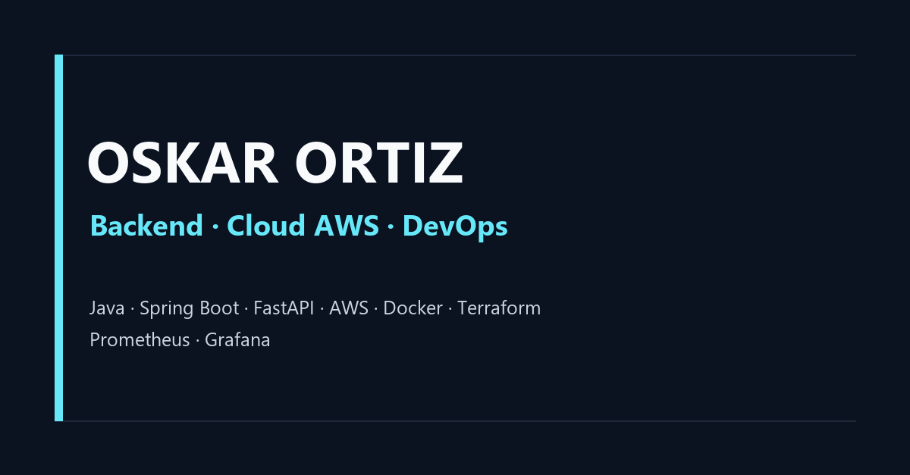

# Portafolio de Oskar Ortiz

Portafolio profesional de Oskar Ortiz, orientado a backend, cloud AWS y DevOps.
El sitio está construido con Next.js App Router, TypeScript y Tailwind CSS, y
se sirve actualmente desde [portfoliowireframe-beta.vercel.app](https://portfoliowireframe-beta.vercel.app).



## Stack

- Next.js 16 con App Router
- React y TypeScript
- Tailwind CSS y CSS modular
- Vercel para despliegue
- Metadata Open Graph, Twitter Cards, sitemap, robots y JSON-LD Person

## Ejecución local

```bash
npm ci
npm run dev
```

Abre `http://localhost:3000` en el navegador.

Para validar la compilación de producción:

```bash
npm run build
npm run start
```

## Configuración

La variable opcional `NEXT_PUBLIC_SITE_URL` permite definir el dominio canónico
del despliegue. Si no existe, el proyecto usa el dominio actual de Vercel como
fallback.

## Calidad y seguridad

- No se deben subir archivos `.env`, tokens, claves privadas ni credenciales.
- El CV descargable esperado es `public/Oskar_Ortiz_CV.pdf`.
- El directorio `.atl/` contiene metadatos locales y no forma parte del commit.
